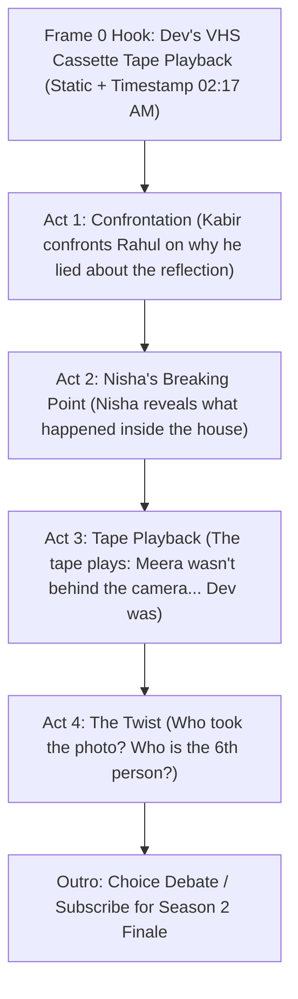

# 🧠 CREATIVE & TECHNICAL BLUEPRINT FOR AI DEVELOPER
**Codebase:** `my-video` (Remotion + Three.js + Neural TTS Engine)  
**Flagship Franchise:** *"Everyone Remembers It Differently"* (Analog & Digital Psychological Horror)  
**Target Channels:** YouTube Shorts (Master & Standalone) & Instagram Reels  

---

## 📖 1. What This Project Is & What It Does

This repository is an **automated, programmatic video production studio** built on **Remotion (React 19 + TypeScript + Three.js)** with a **Python-powered Neural Audio & SFX pipeline**. 

It produces high-retention, cinematic vertical (9:16) animated psychological horror shorts that achieve **>70% Average View Duration (AVD)** and are engineered specifically for viral algorithm triggers (**VVSA hook retention, 1-word comment polarization, and Instagram DM shares/saves**).

### The Story Lore: *"Everyone Remembers It Differently"*
- **Premise**: Arjun receives an automated message at 2:17 AM from his deceased best friend Dev (*"YOU SAID YOU WOULDN'T TELL THEM."*).
- **The Clue**: An old photograph taken the night Dev died reveals an unexplained **6th person** in the 2nd-floor broken window—matching Arjun's exact jacket, angle, and reflection.
- **The Mystery**: On the back of the photo, Dev had written in marker: *"IF WE FORGET, WATCH THE VIDEO."* Arjun wrote it in his handwriting, but has zero memory of doing so.
- **The Conflict**: The 5 surviving friends all remember the events of that night completely differently.

---

## 👥 2. Character Roster & Procedural Rigging System

All characters are procedural stick figures powered by a custom **Inverse-Kinematics (IK) 2D animatable rig** (`FriendRig.tsx`). Joints, breathing, blinks, head tilts, props, and rim lighting are fully controllable via code.

### The 6 Core Characters (`src/part2/stick/friendDesigns.ts` & `src/stick/`):

| Character | Rig ID | Signature Color | Accents & Props | Personality & Narrative Role |
| :--- | :---: | :---: | :--- | :--- |
| **Arjun** | `"arjun"` | **Electric Blue** (`#38bdf8`) | Dark green jacket, cross-chest backpack strap, inquisitive eyes | **Protagonist**. Discovers the 2:17 AM messages and the 6th figure in the window. |
| **Dev** | `"dev"` | **Crimson / Deceased** (`#ff4d5a`) | Blue stick figure, curly hair, pulsing death aura (`💀`), left-handed writer | **The Deceased Friend**. Died 1 year ago on Oct 31. His restored backup kicks off the mystery. |
| **Rahul** | `"rahul"` | **Forest Green** (`#4ade80`) | Khaki jacket, green bucket hat, hands-in-pockets stance | **The Skeptic**. Insists the figure in the window is just a reflection. |
| **Meera** | `"meera"` | **Vibrant Pink** (`#f472b6`) | Magenta stick figure, long ponytail, DSLR camera prop | **The Photographer**. Took the group photo. Whispers the chilling clue: *"Why does that person look like Arjun?"* |
| **Kabir** | `"kabir"` | **Teal / Cyan** (`#22d3ee`) | Thick cyan spectacles/glasses, tall build, assertive pose | **The Debater**. Clashes with Rahul; insists a reflection in that window is physically impossible. |
| **Nisha** | `"nisha"` | **Amber Gold** (`#fbbf24`) | Warm amber stick figure, side ponytail, hesitant/traumatized posture | **The Silent Witness**. Goes completely quiet when the photo is inspected. Hiding a dark secret. |

### How to Pose and Render a Character in Code:
```tsx
import { FriendRig, stancePose } from "./rig/FriendRig";

// 1. Generate or modify a pose
const myPose = {
  ...stancePose("meera"),
  prop: "camera",        // "camera" | "marker" | "phone" | "none"
  propAmt: 1.0,          // 0..1 transition
  headTilt: -4,          // degrees
  lean: 3,               // degrees torso lean
  eyeOpen: 1.1,          // 0 (closed) to 1.2 (wide shock)
  breath: Math.sin(f * 0.15) * 1.2,
};

// 2. Render the rig with hardware-accelerated SVG
<FriendRig 
  id="meera" 
  pose={myPose} 
  width={240 * scale} 
  height={440 * scale} 
  jacket={false} 
  mirror={false} 
  rim={0.25}            // Edge light intensity
  cool={0.15}           // Ambient blue/morning tint
/>
```

---

## 🏗️ 3. Architecture & Key Files Directory Map

```
my-video/
├── src/
│   ├── Root.tsx                       # Master Remotion composition registry
│   ├── part1/                         # Part 1 ("The Message") - 57.0s master
│   ├── part1_experiment/              # Part 1 Paced experiment (read-time pauses)
│   ├── part2/                         # Part 2 ("The Extra Person")
│   │   ├── Part2.tsx                  # Standalone cut (57.0s, infinite loop)
│   │   ├── Part2WithOutro.tsx         # Master cut with Subscribe Outro (61.0s)
│   │   ├── Photo.tsx                  # The Photograph, 6th person, forensic zoom, marker writing
│   │   ├── Room.tsx                   # Living room plate, 5 friends choreo, speech bubbles
│   │   ├── captions.ts                # Waveform-aligned JSON timestamps & chunking
│   │   ├── captions_loop.ts           # 50s Viral Loop timestamps & subtitles
│   │   ├── CaptionsLayer.tsx          # Dynamic word highlight subtitles (yellow/red keywords)
│   │   ├── CaptionsLayerLoop.tsx      # Subtitles optimized for 50s Loop Cut
│   │   ├── Part2.tsx                  # Part 2 Standalone (57.0s)
│   │   ├── Part2WithOutro.tsx         # Part 2 Master with Outro (61.0s)
│   │   ├── Part2Loop.tsx              # Part 2 Viral Loop Cut (50.0s, >100% Retention Loop)
│   │   ├── Outro.tsx                  # YouTube Like & Subscribe morphing outro with character rigs
│   │   ├── EndCardLoop.tsx            # 1.5s seamless loop flash card
│   │   ├── sfx.ts & SfxLayer.tsx      # Comprehensive sound effects mixer
│   │   ├── SfxLayerLoop.tsx           # 50s calibrated sound mixer
│   │   ├── rig/FriendRig.tsx          # Master 2D inverse-kinematics stick figure rig
│   │   └── fx/Overlays.tsx            # Film grain, CRT glitches, vignette, color washes
│   ├── part3/                         # Part 3 ("Five Different Memories")
│   │   ├── Part3.tsx                  # Standalone cut (54.0s, infinite loop)
│   │   ├── Part3WithOutro.tsx         # Master cut with Subscribe Outro (58.0s)
│   │   ├── Room.tsx                   # Living room plate, 5 friends choreo & floating tags
│   │   ├── Memory.tsx                 # 4 memory panels, branching timeline, 2:17 AM silence
│   │   ├── scenes.tsx                 # Rahul, Meera, Kabir, Nisha memories & Hallway rec scene
│   │   ├── CaptionsLayer.tsx          # Waveform-aligned dynamic subtitles
│   │   └── Outro.tsx                  # YouTube Subscribe & Comment Debate Outro (Rahul vs Meera)
│   ├── instagram/
│   │   ├── InstagramOutro.tsx         # Instagram Reels Outro (+FOLLOW button, DM shares, Saves)
│   │   ├── Part1Instagram.tsx         # Part 1 Reels edition (61.0s)
│   │   ├── Part2Instagram.tsx         # Part 2 Reels edition (61.0s)
│   │   └── Part3Instagram.tsx         # Part 3 Reels edition (58.0s)
│   └── stick/                         # 2D character stick figure components & designs
│
├── scripts/                           # Python Audio & Sound Processing Pipeline
│   ├── build_part3_voiceover.py       # Master Part 3 neural voiceover generator (Brian + Aria)
│   ├── build_part2_viral_voiceover.py # Master Part 2 voiceover generator with edge-tts & reverb
│   ├── build_part2_viral_loop_voiceover.py # 50.0s Viral Loop voiceover (Brian + Andrew multilingual)
│   ├── build_full_voiceover.py        # Part 1 voiceover generator
│   └── check_yt_handles.py            # Live YouTube handle availability checker
│
├── public/
│   ├── audio/                         # Master voiceover.wav, voiceover_part2.wav, sfx assets
│   ├── backgrounds/                   # exterior.jpg (house), living_room.jpg, bedroom.jpg
│   └── fx/                            # paper_back.png, glitch textures
│
└── output final videos/               # Master deliverables vault
    ├── instagram/                     # Dedicated Instagram Reels MP4s & strategy README
    └── experimental/                  # Pacing & retention experiment MP4s
```

---

## 📐 4. Functional Requirements (FRs) & Engineering Rules

Any AI creating new scenes or parts (like **Part 3**) MUST strictly obey these rules:

### **FR-1: Resolution, Aspect Ratio & Framerate**
- **Canvas Size**: `1080 × 1920` (9:16 vertical standard for Shorts & Reels).
- **Framerate**: **30 fps** (Strictly enforced across all math, keyframes, and timing).
- **Target Durations**:
  - Standalone Cuts: **57.0s** (`1710 frames`) — optimized for APV > 100% with infinite-loop backlink.
  - Master Cuts with Outro: **61.0s** (`1830 frames`) — 57.0s episode + 4.0s (120 frames) Outro.

### **FR-2: Safe Zones (Crucial for Mobile UI Overlays)**
Never place text, critical forensic clues, or character faces in platform UI blindspots:
- **YouTube Shorts Safe Margins**:
  - Top: avoid top 120px (search/sound bar).
  - Bottom: avoid bottom 240px (channel name, title, audio pill).
  - Right: keep 120px buffer from right edge (Like, Dislike, Comment, Share icons).
- **Instagram Reels Safe Margins**:
  - Top: avoid top 180px (Reels title, camera icon).
  - Bottom: avoid bottom 270px (account handle, multi-line caption, audio disc).
  - Right: keep 130px buffer from right edge (like, comment, send, save stack).

### **FR-3: Audio & Voiceover Rules (No Childish Voices!)**
- **The Narrator Voice**: Strictly use **`en-US-BrianMultilingualNeural`** with deep pitch tuning (`pitch: "-2Hz"` to `"-4Hz"`, `rate: "-2%"` to `"+4%"`). It delivers grave, mature psychological horror authority.
- **Female Characters (Meera / Nisha)**: Strictly use **`en-US-AriaNeural`** or **`en-US-AvaMultilingualNeural`** tuned to a slow, terrified whisper (`rate: "-6%"`, `pitch: "-2Hz"`, subtle plate reverb). NEVER use high-pitched peppy voices like `JennyNeural`.
- **Male Characters (Rahul / Kabir / Dev)**: Use deep, natural voices (`en-US-AndrewMultilingualNeural`, `en-US-ChristopherNeural`, or Brian). NEVER use cartoonish voices like `GuyNeural` or `EricNeural`.
- **Tension Silence**: Always build **1.5s to 2.5s of dead silence** (no voiceover, only heartbeat/sub-bass drone) during major text reveals (reading handwriting, forensic match, date reveals). Viewers need reading time!

### **FR-4: Character Visual Identity (Floating Tags)**
- When characters appear in a group (e.g. in the photo or living room), **always render floating glowing pill badges above their heads**:
  - `RAHUL`, `NISHA`, `ARJUN`, `DEV 💀`, `KABIR`.
  - Style: Frosted dark background `rgba(8, 12, 22, 0.9)`, 2px glowing border in their signature color, uppercase monospace bold font, and gentle vertical floating oscillation `Math.sin(f * 0.08) * 3px`.

### **FR-5: Forensic Clue Visibility (The Window / Background Anomaly)**
- Background anomalies (such as the 6th figure in the window) **MUST be naturally discernible when a viewer pauses the video at 1x unzoomed scale**:
  - Never set clue opacity to 0 until the camera zooms in. Keep base opacity at `0.88`–`0.96`.
  - Provide interior moonlight backlighting inside the window opening so it separates from the wall.
  - Give figures pale rim lighting (`drop-shadow(0 0 6px rgba(180,225,255,0.9))` and pale reflective eyes piercing through the dark glass.
  - Add physical specular glass reflections across the pane.

### **FR-6: Hardware Accelerated Rendering**
- The project runs on an **NVIDIA GeForce RTX 3050 Laptop GPU**.
- Always render with the ANGLE GPU pipeline and 4x concurrency:
  ```bash
  npx remotion render src/index.ts <CompositionId> "<OutputFile.mp4>" --concurrency=4 --gl=angle
  ```
- **Selective Rendering**: Never re-render the entire project when making changes to a single part. Render ONLY the modified composition!

---

## 🎬 5. The Blueprint for Part 3 ("Five Different Memories" / The Series Climax)

When coding **Part 3**, follow this narrative and technical architecture:



### Proposed Dialogue & Sound Cues for Part 3:
1. **Hook (0s - 4.5s)**:
   - Visual: VHS static burst, magnetic tape warble, date stamp `OCTOBER 31 · 02:17 AM`.
   - Voice (Narrator): *"Everyone remembered that night differently. But the tape remembered everything."*
2. **The Confrontation (4.5s - 18s)**:
   - Visual: Living room tense standoff. Floating tags above Kabir and Rahul.
   - Dialogue: Kabir: *"The reflection is impossible, Rahul. You know who was on the second floor."*
3. **Nisha's Secret (18s - 32s)**:
   - Visual: Camera zooms into Nisha. Trembling hands, amber tag pulsing.
   - Voice (Nisha): *"We promised we'd never speak his name again."*
4. **The Tape Reveal (32s - 48s)**:
   - Visual: Old CRT monitor flickering. The footage of Meera holding the camera... but Arjun is standing next to her!
   - Voice (Narrator): *"Dev didn't take the photo. Dev was the one being watched."*
5. **Infinite Loop Outro (48s - 57s)**:
   - Blackout whisper: *"Check the tape from the beginning..."*

---

## 🚀 6. Essential Terminal Commands

```bash
# 1. Start Remotion Preview Studio
npm run dev

# 2. Type-check TypeScript with zero errors
npx tsc --noEmit

# 3. Generate Part 2 Voiceover & update captions.ts
python scripts/build_part2_viral_voiceover.py

# 4. Render Part 2 Master (With Outro)
npx remotion render src/index.ts Part2WithOutro "output final videos/Everyone_Remembers_Part2_The_Extra_Person_Master_With_Outro.mp4" --concurrency=4 --gl=angle

# 5. Render Part 2 Standalone (Infinite Loop)
npx remotion render src/index.ts Part2 "output final videos/Everyone_Remembers_Part2_The_Extra_Person_Standalone.mp4" --concurrency=4 --gl=angle

# 6. Render Part 2 Instagram Reel
npx remotion render src/index.ts Part2Instagram "output final videos/instagram/Everyone_Remembers_Part2_Instagram_Reel.mp4" --concurrency=4 --gl=angle

# 7. Render Part 3 Master (With Outro)
npx remotion render src/index.ts Part3WithOutro "output final videos/Everyone_Remembers_Part3_Five_Memories_Master_With_Outro.mp4" --concurrency=4 --gl=angle

# 8. Render Part 3 Standalone (Infinite Loop)
npx remotion render src/index.ts Part3 "output final videos/Everyone_Remembers_Part3_Five_Memories_Standalone.mp4" --concurrency=4 --gl=angle

# 9. Render Part 3 Instagram Reel
npx remotion render src/index.ts Part3Instagram "output final videos/instagram/Everyone_Remembers_Part3_Instagram_Reel.mp4" --concurrency=4 --gl=angle
```

---
*This handover document guarantees that any AI or developer stepping into this repository can immediately write code, pose characters, generate audio, and maintain the exact cinematic horror quality standard.*

